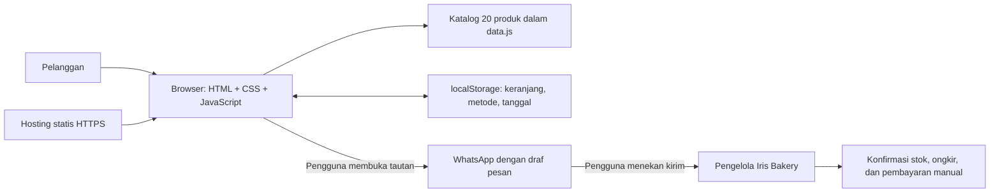
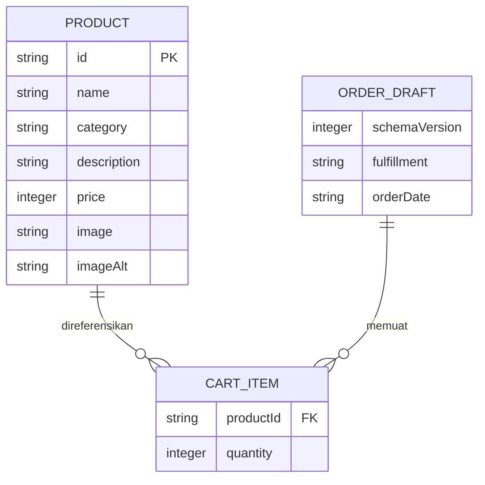

# Arsitektur Sistem — Iris Bakery

## 1. Bentuk sistem
Aplikasi frontend statis satu halaman, dibagi menjadi berkas JavaScript berurutan (skrip klasik). Ini bukan microservices dan tidak memiliki backend monolith. Server hosting hanya mengirimkan HTML, CSS, JavaScript, dan gambar. Seluruh pencarian serta perhitungan berjalan di browser.



## 2. Struktur berkas aplikasi
Struktur berikut sesuai implementasi.
```text
iris-bakery/
├── index.html
├── css/styles.css
├── js/
│   ├── config.js       # Identitas usaha, nomor WhatsApp publik, masa tunggu minimum
│   ├── data.js         # Data katalog 20 produk
│   ├── app.js          # Inisialisasi, render, pencarian, filter
│   ├── cart.js         # Manipulasi keranjang dan perhitungan murni
│   ├── storage.js      # Baca/tulis aman, validasi skema
│   └── checkout.js     # Validasi formulir dan pembentukan tautan
├── assets/images/      # Foto produk <id>.webp dari pemilik usaha, hero, dan fallback
├── README.md
├── package.json
├── scripts/package_site.py
├── tests/iris.test.js
├── prd.md
├── tech_stack.md
├── arsitektur.md
├── ui.ux.md
├── instruction.md
└── verification.md
```
Repository juga memuat `README.md`, `package.json`, pengujian pada `tests/`, dan skrip pembuat paket statis pada `scripts/`. Berkas dokumentasi tidak masuk paket publik.

## 3. Model data

Diagram menggambarkan hubungan objek frontend, bukan tabel database yang sudah tersedia. Kategori memakai dua nilai: `dessert-bakery` (12 produk) dan `drinks` (8 produk). `fulfillment` bernilai `pickup` atau `delivery`. Nama, nomor, alamat, dan catatan pelanggan bersifat sementara pada formulir, terpisah dari data persisten. Subtotal dan total adalah nilai turunan yang dihitung ulang.

Contoh penyimpanan dengan kunci `iris-bakery:cart:v1`:
```json
{
  "schemaVersion": 1,
  "items": [
    { "productId": "og-salt-bread", "quantity": 2 },
    { "productId": "mocha-latte", "quantity": 1 }
  ],
  "fulfillment": "pickup",
  "orderDate": "2026-11-10"
}
```

## 4. Alur kerja
### Memuat halaman
1. Muat konfigurasi dan katalog lokal.
2. Baca localStorage dalam `try/catch`.
3. Validasi versi, tipe data, ID produk yang dikenal, jumlah bulat 1–99, metode yang dikenal, dan bentuk tanggal. Abaikan entri rusak atau ID yang tidak ada; versi tak dikenal direset.
4. Tanggal yang kurang dari batas minimum dihapus dan pengguna diminta memilih ulang.
5. Render katalog, keranjang, dan total dengan harga katalog terkini.

### Mengubah keranjang
1. Terima ID produk dari kontrol UI dan cocokkan dengan katalog.
2. Tambah atau ubah jumlah dalam state tunggal.
3. Hitung ulang total produk.
4. Render dan simpan bagian state yang diperbolehkan.
5. Jika penyimpanan gagal, pertahankan state sesi dan tampilkan pemberitahuan singkat.

### Mengajukan pesanan
1. Validasi keranjang, metode, tanggal, nama setelah trim, nomor kontak, dan alamat bila metode antar.
2. Tampilkan ringkasan final beserta keterangan estimasi, konfirmasi stok, dan biaya tambahan (ongkir) yang belum dihitung.
3. Susun teks dari katalog dan state terbaru; encode seluruh teks memakai `encodeURIComponent`.
4. Bentuk `https://wa.me/<nomor-usaha>?text=<pesan>` dari konfigurasi nomor internasional berupa digit saja.
5. Buka tautan melalui tindakan pengguna. Tidak mengirim pesan secara otomatis dan tidak menampilkan status “pesanan berhasil”.
6. Pertahankan keranjang setelah pengalihan; pengajuan yang sama mungkin dibuka ulang dan belum menjadi transaksi.

## 5. Perhitungan tanggal dan biaya
Parse `YYYY-MM-DD` menjadi komponen angka, validasi kembali komponennya (termasuk tahun kabisat), dan bandingkan dengan tanggal lokal hari ini yang dibentuk dari komponen tahun, bulan, dan hari lokal; hindari `toISOString()` untuk menentukan hari lokal. Tanggal pesanan valid bila sama dengan atau setelah hari ini ditambah `MIN_LEAD_DAYS` (asumsi 1). Penambahan hari memakai `Date.UTC(year, month - 1, day + n)` agar lintas bulan dan tahun benar. Subtotal = harga × jumlah; total = jumlah subtotal. Nilai uang adalah integer rupiah. Ongkos kirim tidak dihitung.

## 6. Integrasi dan batas kepercayaan
WhatsApp merupakan satu-satunya integrasi pihak ketiga MVP, melalui tautan biasa tanpa SDK/API. Data kontak, alamat, dan rincian pesanan akan masuk ke URL WhatsApp saat pengguna menekan tombol; beri penjelasan di dekat tombol. Jangan minta data sensitif seperti nomor identitas atau data kartu. Browser dan localStorage dapat dimodifikasi pengguna, sehingga total hanya merupakan estimasi dan harus diperiksa pengelola.

## 7. Keamanan dan penanganan kegagalan
Gunakan `textContent` untuk input pengguna dan data dinamis; hindari interpolasi input ke `innerHTML`. Jika memakai tab baru, gunakan `rel="noopener noreferrer"`. Tidak ada rahasia atau validasi stok yang dipercaya dari browser. Foto yang gagal dimuat memiliki fallback lokal. Pencarian kosong, tanggal salah, storage tidak tersedia, dan konfigurasi nomor usaha tidak valid memiliki keadaan UI yang jelas. Situs masih dapat menampilkan konten dasar saat JavaScript gagal, dengan pesan `noscript` untuk fitur interaktif.

## 8. Deployment
Unggah aset runtime ke hosting statis melalui HTTPS. Tidak ada proses build, migrasi database, atau fungsi server. Dokumentasi tetap di repository dan tidak perlu masuk paket publik. Untuk rollback, unggah ulang paket runtime versi sebelumnya. Panduan operasional ada di `instruction.md`.
